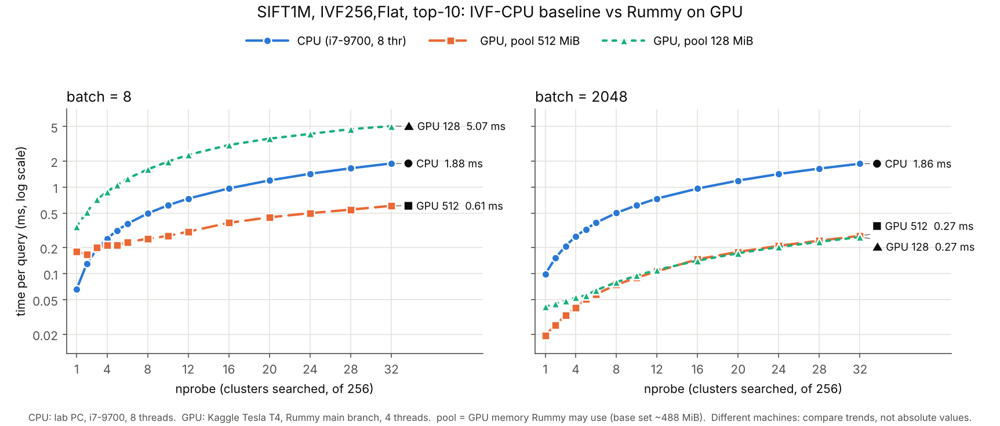
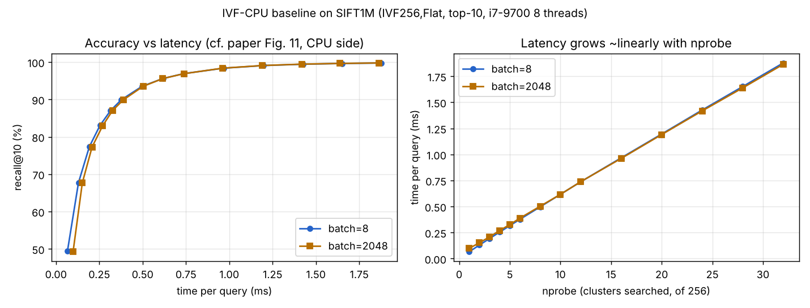

# rummy-cpu-baseline

Reproducing *Rummy* (NSDI '24) at SIFT1M scale: the **IVF-CPU baseline** on a CPU-only PC, and **Rummy itself** on a Kaggle Tesla T4 GPU.

> Zili Zhang, Fangyue Liu, Gang Huang, Xuanzhe Liu, Xin Jin. **Fast Vector Query Processing for Large Datasets Beyond GPU Memory with Reordered Pipelining.** NSDI 2024.
> [Paper](https://www.usenix.org/conference/nsdi24/presentation/zhang-zili-pipelining) · [Official code](https://github.com/pkusys/Rummy)

本仓库在 SIFT1M（100 万条向量）规模上复现论文 §6.1 **Fig. 10、Fig. 11** 的两半：

- **CPU 对照组（IVF-CPU）**：官方仓库的 `cpu` 分支，在实验室的 i7-9700 上运行。
- **Rummy 本体（GPU）**：官方仓库的 `main` 分支，在 Kaggle 的 Tesla T4 上运行。另外把 Rummy 可用的显存人为限制到 128 MiB（约为底库的 1/4），模拟论文“数据比显存大”的场景。



图中三条线用**线型 + 标记形状 + 线尾文字**区分，不依赖颜色：实线 ● 是 CPU，虚线 ■ 是 GPU（显存池 512 MiB），点线 ▲ 是 GPU（显存池 128 MiB）。纵轴是对数坐标。

## 复现了什么

| 论文 | 内容 | 本仓库 |
|---|---|---|
| Fig. 9 | Rummy vs IVF-Rotation vs IVF-CUM | ✗（另外两个 GPU 基线没有跑） |
| **Fig. 10** | Rummy vs IVF-CPU，batch 8 / 2048 | **两半都有**（SIFT1M 规模） |
| **Fig. 11** | 精度 vs 每条查询耗时，nprobe 1–32 | **两半都有**（SIFT1M 规模） |
| Fig. 12–15、Table 3 | 各项技术的消融实验 | ✗ |
| — | 显存放不下全部数据时的表现 | **额外做了**：显存池 512 MiB vs 128 MiB |

| 设置 | 论文 | 本仓库：CPU | 本仓库：GPU |
|---|---|---|---|
| 代码 | `main` / `cpu` 分支 | `cpu` 分支，改写为 `bench_cpu_small`，搜索逻辑相同 | `main` 分支（commit `accf7f8`）+ [`gpu/rummy.patch`](gpu/rummy.patch) |
| 索引 | IVF，Flat | `IVF256,Flat` | `IndexIVFPipe`，nlist = 256 |
| nprobe | 1–32 | 1–32（14 个值） | 相同 |
| batch | 8、2048 | 8、2048 | 相同 |
| top-k | 10 | 10 | 10 |
| 数据 | SIFT1B 等（十亿级） | SIFT1M | 同一份 SIFT1M（md5 一致） |
| 机器 | GPU：AWS p4d.24xlarge，用 1 张 A100 40 GB，PCIe 4.0；CPU：AWS x1.16xlarge，64 vCPU | Intel i7-9700（8 核 8 线程），16 GB，Ubuntu 20.04 | Kaggle：Tesla T4 16 GB（只用 1 张），4 vCPU，31 GB 内存，CUDA 13.0，Ubuntu 24.04 |
| 线程数 | — | 8 | 4 |
| GPU 可用显存 | 整张卡 | — | 512 MiB 和 128 MiB 两组（底库约 488 MiB） |

数据规模和机器都和论文差很多，CPU 和 GPU 也不在同一台机器上，**绝对数值不能和论文直接比较，只比较曲线形状和趋势**。

## 结果一：IVF-CPU（SIFT1M）

完整数据见 [`results/sift1m.csv`](results/sift1m.csv)。



| nprobe | 搜索数据比例 | recall@10 | 每条查询 (ms)，batch 8 | 每条查询 (ms)，batch 2048 |
|---:|---:|---:|---:|---:|
| 1 | 0.4% | 49.40% | 0.066 | 0.099 |
| 2 | 0.8% | 67.71% | 0.130 | 0.152 |
| 4 | 1.6% | 83.08% | 0.254 | 0.270 |
| 8 | 3.1% | 93.51% | 0.497 | 0.503 |
| 16 | 6.3% | 98.37% | 0.967 | 0.962 |
| 32 | 12.5% | 99.75% | 1.878 | 1.865 |

（recall 列为 batch 8 的结果；batch 2048 只用了 10000 条查询中的 8192 条，recall 相差不到 0.2 个百分点。）

**观察**

1. **只搜少量簇就有很高的精度**：nprobe = 8（全库的 3%）时 recall@10 已达 93.5%，nprobe = 32（12.5%）时达 99.75%。与论文 §2.1 “只搜约 1% 数据即可达约 99% 准确率”所描述的现象一致。
2. **耗时与 nprobe 近似成正比**：nprobe 增大 32 倍，耗时增大约 28 倍，耗时主要来自扫描簇内向量。
3. **batch 大小几乎不影响 CPU 上每条查询的耗时**：Faiss CPU 按查询并行，每条查询各自扫描自己的簇。论文对 Fig. 10 的解释是：大 batch 给 GPU 带来更高的计算并行度，却让 CPU 方案的计算相互干扰。在我们这台 8 核机器、SIFT1M 规模上，**看不到这种干扰**。可能是因为数据小、能部分放进 CPU 缓存，而论文用的是 64 vCPU 和数百 GB 的数据；这一点是推测，用本仓库的数据无法验证。

冒烟测试（siftsmall，nlist = 64）的结果在 [`results/siftsmall.csv`](results/siftsmall.csv)。该数据集太小，一次实验只有十几毫秒，耗时主要是线程开销，**只有 recall 一列有参考价值**。

## 结果二：Rummy on GPU（SIFT1M）

完整数据见 [`results/sift1m_gpu.csv`](results/sift1m_gpu.csv)（56 行 = 14 个 nprobe × 2 种 batch × 2 种显存池）。

**每条查询耗时 (ms)**，括号里是相对 CPU 的加速比（> 1 表示 GPU 更快）：

| nprobe | recall@10 | CPU，batch 8 | GPU 512，batch 8 | GPU 128，batch 8 | CPU，batch 2048 | GPU 512，batch 2048 | GPU 128，batch 2048 |
|---:|---:|---:|---:|---:|---:|---:|---:|
| 1 | 49.29% | 0.066 | 0.180（0.37×） | 0.352（0.19×） | 0.099 | 0.019（5.1×） | 0.041（2.4×） |
| 2 | 67.52% | 0.130 | 0.167（0.78×） | 0.517（0.25×） | 0.152 | 0.026（6.0×） | 0.045（3.4×） |
| 4 | 82.83% | 0.254 | 0.214（1.19×） | 0.885（0.29×） | 0.270 | 0.041（6.7×） | 0.053（5.1×） |
| 8 | 93.20% | 0.497 | 0.253（2.0×） | 1.601（0.31×） | 0.503 | 0.075（6.7×） | 0.080（6.3×） |
| 16 | 98.04% | 0.967 | 0.387（2.5×） | 3.067（0.32×） | 0.962 | 0.147（6.5×） | 0.142（6.8×） |
| 32 | 99.45% | 1.878 | 0.609（3.1×） | 5.068（0.37×） | 1.865 | 0.274（6.8×） | 0.266（7.0×） |

（recall 列为 GPU、batch 8、显存池 512 的结果。“GPU 512 / 128”指 Rummy 可用的显存池大小，单位 MiB。）

**显存池 128 MiB 时，每条查询的时间拆分 (ms)**：

| nprobe | batch | 计算 comp | 传输 trans | 理想下限 opt = max(comp, trans) | 实测 query |
|---:|---:|---:|---:|---:|---:|
| 1 | 8 | 0.026 | 0.196 | 0.198 | 0.352 |
| 8 | 8 | 0.083 | 1.431 | 1.432 | 1.601 |
| 32 | 8 | 0.273 | 4.013 | 4.013 | 5.068 |
| 1 | 2048 | 0.011 | 0.030 | 0.030 | 0.041 |
| 8 | 2048 | 0.066 | 0.034 | 0.066 | 0.080 |
| 32 | 2048 | 0.249 | 0.033 | 0.249 | 0.266 |

**发现**

1. **搜索结果正确，且和显存池大小无关**：同一格两种显存池的 recall 最多差 0.02 个百分点；GPU 与 CPU 的 recall 最多差 0.33 个百分点，GPU 一致略低。两边训练索引的代码不同（Faiss `index_factory` vs Rummy 的 `IndexIVFPipe`），差异可能来自这里，没有深究。
2. **显存池 512 MiB 基本相当于“数据全在显存里”**：每条查询的传输时间只有 0.01–0.06 ms。
3. **大 batch：GPU 在所有 nprobe 下都比 CPU 快**，两种显存池都是。nprobe = 32 时约快 7 倍，nprobe = 1 时快 2.4–5.1 倍。
4. **小 batch：结果取决于显存够不够**。
   - 显存池 512 MiB：nprobe ≤ 3 时比 CPU 慢，nprobe = 4 起反超，nprobe = 32 时快 3.1 倍。
   - 显存池 128 MiB：在所有 nprobe 下都比 CPU 慢（nprobe = 32 时慢 2.7 倍）。时间几乎都花在传输上：5.07 ms 里有 4.01 ms 是传输。
5. **大 batch 下，传输被两个机制消化掉了**（这是我们从拆分数据读出的解释）：
   - **按簇改造（cluster-based retrofitting）摊薄了传输**：显存池 128、batch 2048 时，每条查询的传输时间稳定在 0.030–0.034 ms，不随 nprobe 增长。因为一个簇搬进显存后，被同一批里很多条查询共用。
   - **流水线（pipelining）把剩下的传输藏住了**：nprobe ≥ 5 时 opt 等于 comp，说明传输完全和计算重叠。batch 8 时计算本身太短（nprobe = 32 也只有 0.27 ms），能拿来遮挡传输的时间不够，传输就露了出来。
6. **显存池 512、大 batch 的优势主要来自摊薄每个 batch 的固定开销**（这也是我们的解读）：nprobe = 32 时，batch 8 和 batch 2048 每条查询的计算时间差不多（0.28 vs 0.26 ms），但实测时间差了一倍多（0.61 vs 0.27 ms），多出来的部分是 comp 和 trans 之外的调度开销，大 batch 把它分摊到了更多查询上。论文把 batch 越大优势越大归因于 GPU 的计算并行度，在我们的 comp 列里看不出这个效应，可能是 SIFT1M 规模太小。
7. **和论文的出入**：论文报告 Rummy 比 IVF-CPU 快 2.4–23.1 倍，并且在 SIFT1B 上任何精度设置下都更快。我们在“小 batch + 显存放不下”这一种情况下 CPU 更快。可能的原因（推测，未验证）：SIFT1M 小，CPU 能吃到缓存、算得很快；T4 走 PCIe 3.0，论文用的是 A100 + PCIe 4.0；论文的 CPU 端要处理数百 GB 数据，受内存带宽限制。

**指标说明**

- `query_ms`：每个 batch 的端到端耗时 ÷ batch 大小。
- `comp_ms`、`trans_ms`：Rummy 自己打印的每个 batch 的计算时间、传输时间，取平均后 ÷ batch 大小。
- `opt_ms`：每个 batch 的 max(计算, 传输) 取平均后 ÷ batch 大小，即计算和传输完全重叠时的理论下限（对应程序里的 `Ave Opt Latency`）。
- `reorder_ms`、`group_ms`：重排序和分组的调度耗时。
- batch 2048 时程序跑 10000 ÷ 2048 = 4 个完整 batch，即 8192 条查询；batch 8 时跑全部 10000 条。

## 运行：CPU

默认项目根目录是 `~/research/rummy`，可以用环境变量 `R`（run_sweep）、`WORK`（setup）、`DATA`（下载脚本）修改。

```bash
git clone https://github.com/taka8rie/rummy-cpu-baseline.git && cd rummy-cpu-baseline
bash scripts/setup.sh                # apt 装依赖，pip 装 CMake ≥ 3.17，克隆官方 cpu 分支并打补丁，编译
bash scripts/get_sift1m.sh           # 下载 SIFT1M（Hugging Face 镜像，约 577 MB）
bash scripts/run_sweep.sh sift1m     # 约十几分钟；结果在 ~/research/rummy/results/sift1m.csv
```

单独运行一次：

```bash
B=~/research/rummy/Rummy/build/eval/bench_cpu_small; D=~/research/rummy/data/sift
$B --base $D/sift_base.fvecs --learn $D/sift_learn.fvecs --query $D/sift_query.fvecs \
   --gt $D/sift_groundtruth.ivecs --nlist 256 --nprobe 8 --bs 8 --k 10 --threads 8
```

`bench_cpu_small` 与原 `eval/overall.cpp` 的区别：搜索逻辑不变（`index_factory("IVF<nlist>,Flat")` → `train` → `add` → 按 batch `search` → recall@k），只是把数据路径、规模、线程数改成命令行参数；支持 `.fvecs` / `.bvecs`；分块读入数据以节省内存；缓存索引文件，扫参时不必重复训练；使用全部查询并加一次不计时的预热。

## 运行：GPU（Kaggle）

实际运行环境是 Kaggle 笔记本 `taka8rie/rummy-gpu-sift1m-benchmark-v2`（Version 1），加速器选 GPU T4 x2，程序只用第一张卡。

```bash
git clone https://github.com/pkusys/Rummy.git && cd Rummy && git checkout accf7f8
git apply --check /path/to/gpu/rummy.patch && git apply /path/to/gpu/rummy.patch
cmake -B build . -DFAISS_ENABLE_GPU=ON -DFAISS_ENABLE_PYTHON=OFF -DCMAKE_CUDA_ARCHITECTURES=75   # T4 = 75
make -C build -j4 overall            # Kaggle 4 vCPU 上约 17 分钟
```

BLAS 等其余 cmake 选项以 Kaggle 笔记本为准；官方 `Setup.md` 用的是 MKL（`-DBLA_VENDOR=Intel10_64_dyn`）。

单独运行一格（数据与 CPU 部分相同，SIFT1M 的四个文件）：

```bash
./build/eval/overall --dataset sift1m \
  --base $D/sift_base.fvecs --learn $D/sift_learn.fvecs --query $D/sift_query.fvecs \
  --gt $D/sift_groundtruth.ivecs --nlist 256 --nprobe 8 --bs 8 --k 10 \
  --threads 4 --pool-mib 512 --nq 10000
```

**`--k` 必须是 10**（见下面“GPU 部分遇到的问题”）。程序最后打印一行 `RESULT ...`，扫参脚本从这一行抽数据写 CSV。

[`gpu/rummy.patch`](gpu/rummy.patch)（7,962 字节，md5 `2a0e0659b96debb1407763567f3ee897`）只改 4 个文件：

| 文件 | 改动 |
|---|---|
| `CMakeLists.txt` | C++ 标准从 11 改为 17，CUDA 也设为 17（CUDA 13 的 CCCL/Thrust 要求 C++17） |
| `faiss/Index.h` | 加 `#include <cstdint>`（GCC 13 下 `uint8_t` 不再被间接引入） |
| `faiss/gpu/CMakeLists.txt` | 编译选项 `-Xcompiler <OpenMP 选项>` 是 nvcc 专用写法，原来也会传给 C++ 编译器；改成只传给 CUDA 源文件 |
| `eval/overall.cu` | 命令行参数（数据路径、nlist、nprobe、batch、k、线程数、显存池、查询数）；新增 `sift1m` 数据集分支；删除读取距离真值文件 `gtD` 的代码；在 `initializeForDevice` 之前调用 `setMaxDeviceSize`；`nprobe` 和查询数可配置；末尾打印 `RESULT` 行 |

**待补**：CSV 里的 `comp_ms`、`trans_ms`、`opt_ms`、`reorder_ms`、`group_ms` 五列来自笔记本里另加的打印语句（只加输出，不改搜索逻辑），这部分改动还没有单独导出成补丁。佐证“不改搜索逻辑”：加了打印的程序在 nprobe = 1、batch = 8 时 recall 为 49.29%，与没加打印的程序完全相同。

运行日志在 [`gpu/logs/`](gpu/logs/)（gzip 压缩）：`build`（编译）、`build_instr`（加打印后重新编译）、`gate`（正式扫参前的校验运行）、`probe_b`（显存池 128 的单格试跑）、`run`（完整扫参）。运行环境信息在 [`gpu/env.txt`](gpu/env.txt)。

## 目录

```
bench/
  bench_cpu_small.cpp     CPU 基准程序（基于 cpu 分支 eval/overall.cpp）
  bench_cpu_small.patch   打到官方 cpu 分支上的补丁（新增上面的文件 + CMake 目标）
gpu/
  rummy.patch             打到官方 main 分支（accf7f8）上的补丁
  env.txt                 Kaggle 运行环境（GPU、CUDA、CMake、内存等）
  logs/                   编译、校验、扫参日志（.gz）
scripts/
  setup.sh                CPU：安装依赖、获取 cpu 分支、打补丁、编译
  get_sift1m.sh           下载 SIFT1M
  get_sift10m.sh          （可选）从 SIFT1B 截取前 1000 万条
  run_sweep.sh            CPU：扫 nprobe 1–32 × batch 8/2048，输出 CSV
  plot_cpu_vs_gpu.py      画首页那张 CPU vs GPU 对比图
results/
  sift1m.csv              CPU 结果
  sift1m_gpu.csv          GPU 结果（含时间拆分）
  sift1m_cpu_vs_gpu.png   CPU vs GPU 对比图
  sift1m_recall_latency.png  CPU 结果图
  siftsmall.csv           CPU 冒烟测试
```

## 复现时遇到的问题：CPU

- Ubuntu 20.04 自带 CMake 3.16，低于项目要求的 3.17；`setup.sh` 用 pip 安装 CMake 3.x。
- 官方 `cpu` 分支的 `eval/overall.cpp` 把数据路径（`/billion-data/...`）和线程数（40 / 64）写死了，所以另写了 `bench_cpu_small`。
- 用 gcc 13 编译官方代码会报 `uint8_t has not been declared`（缺 `#include <cstdint>`），可加 `-DCMAKE_CXX_FLAGS="-include cstdint"`；Ubuntu 20.04 的 gcc 9 无此问题。
- TEXMEX 官方 FTP 速度慢，改用 Hugging Face 镜像。
- 网络慢时 `git clone` 中途断开；`setup.sh` 支持把源码包 `rummy_src.tar.gz` 放在 `scripts/` 下离线解压。

## 复现时遇到的问题：GPU

- **显存池默认 36 GiB**：`faiss/gpu/PipeGpuResources.cpp` 里的 `kMaxDeviceMem` 是按 A100 40 GB 定的，`initializeForDevice` 会直接按这个大小 `cudaMalloc`，在 16 GB 的卡上必然失败（`PipeStack: alloc fail`）。要在它之前调用 `setMaxDeviceSize(...)`，大小必须是 1 MiB 的整数倍。
- **`eval/overall.cu` 写死的地方**：没有 SIFT1M 分支（只有指向 sift40M、deep50M 等的路径）；训练集指向 1000 万条的文件；`omp_set_num_threads(8)`；`nq = 10000`；`nprobe = nlist / 32`。`Ave Latency` 是每个 batch 的耗时，不是每条查询的。
- **距离真值文件 `gtD`**：程序会读它，但算 recall 时不用。读它的那行会改写变量 `k`（真值文件的行宽，也是取真值时的步长），所以不能随便放一个假文件顶替，要直接删掉那段代码。
- **`--k`（搜索的 top-k）和变量 `k`（真值行宽，SIFT1M 是 100）是两回事**。第一次重跑时误用了 `--k 100`，出现两个异常：
  - recall 变低（nprobe = 1 时 42.09% vs 49.29%）。因为 recall 是拿返回的前 `input_k` 个和真值的前 `input_k` 个比，`--k 100` 时算的其实是 100 对 100 的 recall，而原程序的输出标签写死成 `recall@10`，把这一点盖住了。
  - batch 2048、nprobe ≥ 5 时程序崩溃（SIGABRT，退出码 134）：`faiss/pipe/PipeCluster.cpp` 的锁页中转栈 `PinTempSize` 写死为 64 MiB，而每组查询的结果缓冲区形状是 `{该组查询数, k}`，k 放大 10 倍后，大 batch、大 nprobe 时就装不下了。改回 `--k 10` 后 56 格全部跑通。
- **补丁要按文件传输，不要手抄**：曾经手抄补丁时吞掉了上下文行的行首空格，`git apply` 直接失败。补丁内容本身没坏，但打不上。
- **Kaggle 的 Quick Save 不保存 `/kaggle/working` 下的输出文件**，会话一停就清空。要用 Save & Run All（Commit），或者停会话前先下载。会话开着时，即使 GPU 闲着也在计配额。
- **Kaggle 访问 IRISA 官网返回 403**。改用 Hugging Face 镜像，见下文“数据来源”。

## 数据来源

- SIFT1M / siftsmall：[TEXMEX corpus](http://corpus-texmex.irisa.fr/)（H. Jégou, M. Douze, C. Schmid）。下载脚本默认使用第三方镜像 [qbo-odp/sift1m](https://huggingface.co/datasets/qbo-odp/sift1m)。
- 已核对：qbo-odp 的四个文件，与另一个镜像 [fzliu/sift1m](https://huggingface.co/datasets/fzliu/sift1m) 里 IRISA 原版 `sift.tar.gz` 解出的文件逐字节一致。CPU 和 GPU 两部分用的是同一份数据：

| 文件 | 向量数 × 维度 | md5 |
|---|---|---|
| `sift_base.fvecs` | 1,000,000 × 128 | `469e2c5345fa5c655db16305970e0b42` |
| `sift_learn.fvecs` | 100,000 × 128 | `15e12462b2b3768ffa2181190afcf9a2` |
| `sift_query.fvecs` | 10,000 × 128 | `f06fa8bb4e856ed05b1df3e25e76a2a0` |
| `sift_groundtruth.ivecs` | 10,000 × 100 | `eea2871c56a0d075306ab058f58759e3` |

## License

MIT。`bench/` 下的代码和 `gpu/rummy.patch` 改编自 [pkusys/Rummy](https://github.com/pkusys/Rummy)（基于 Faiss，MIT License）。
